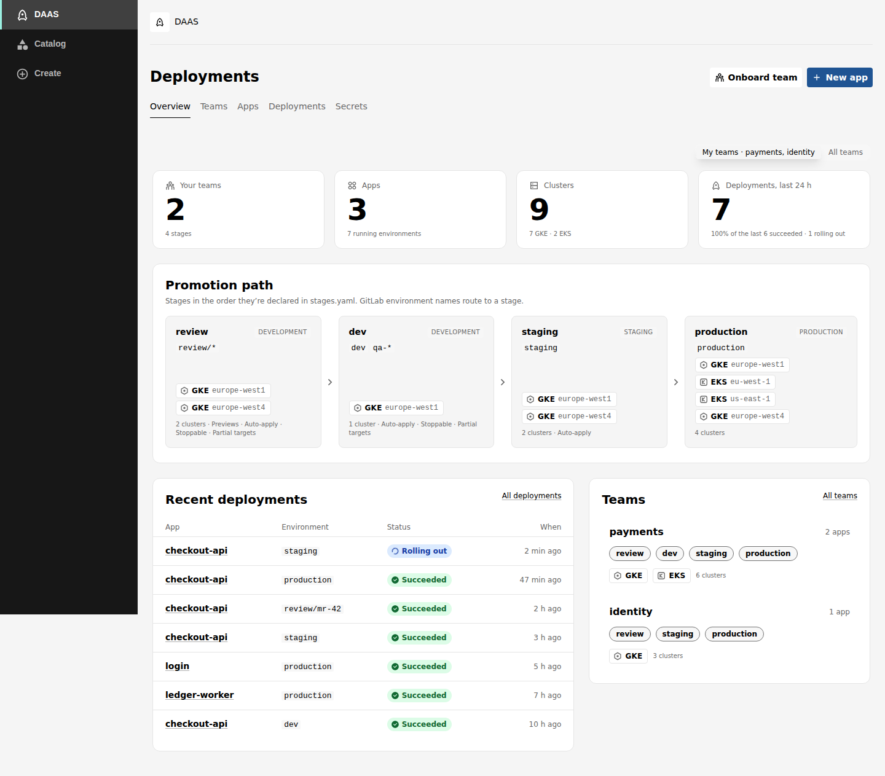
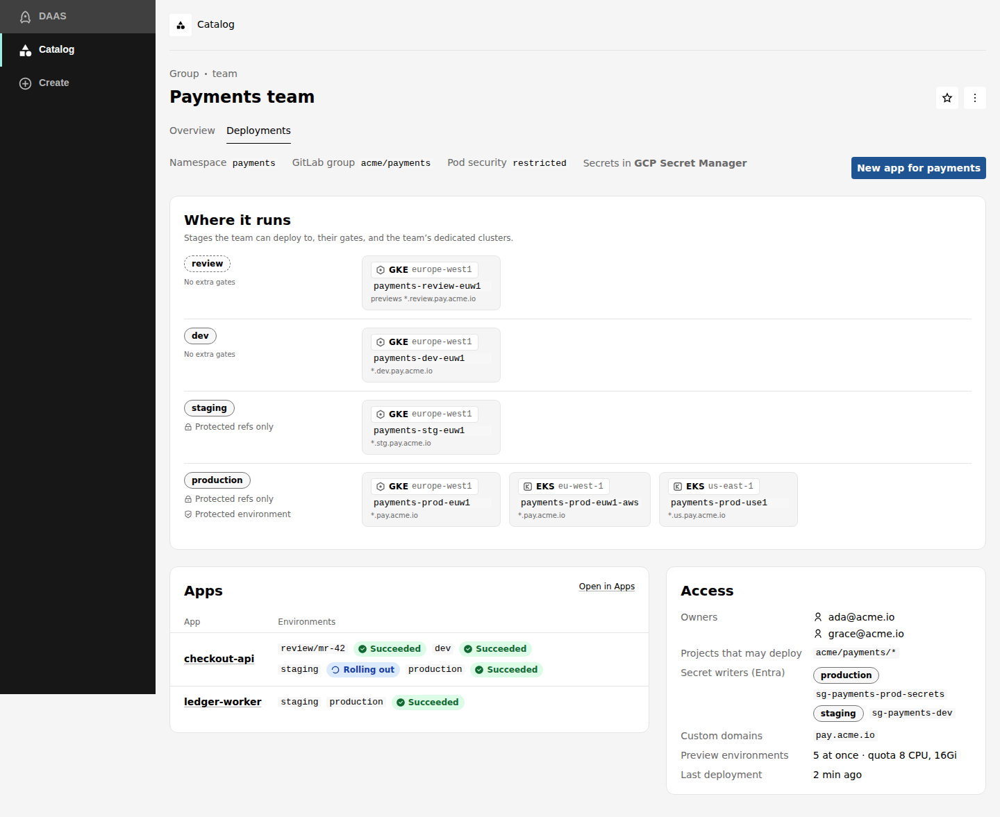
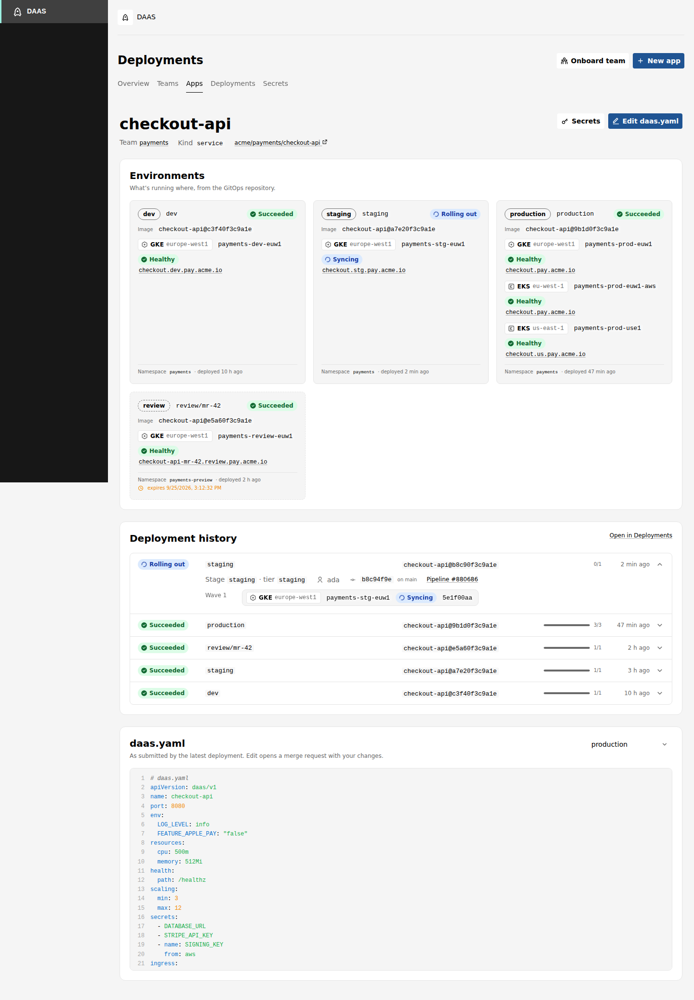
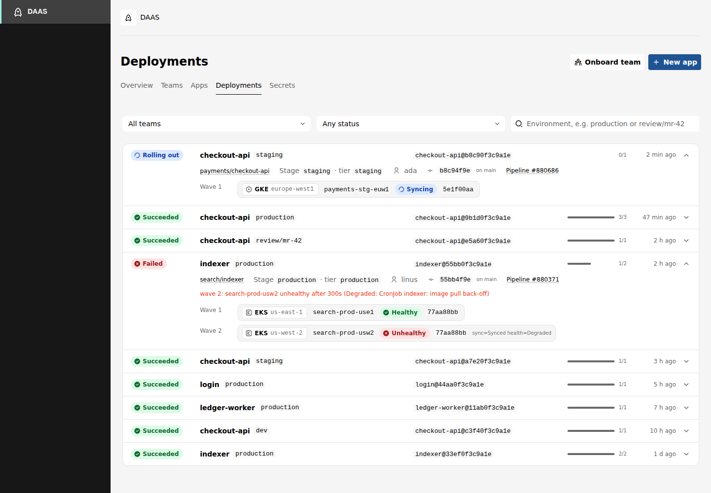
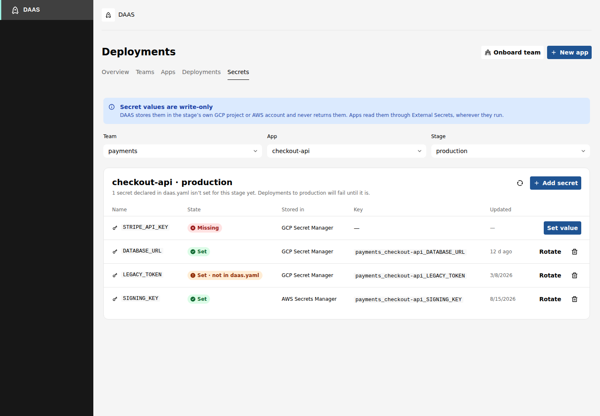
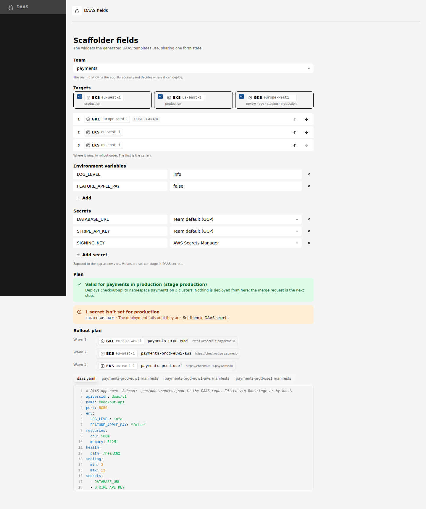
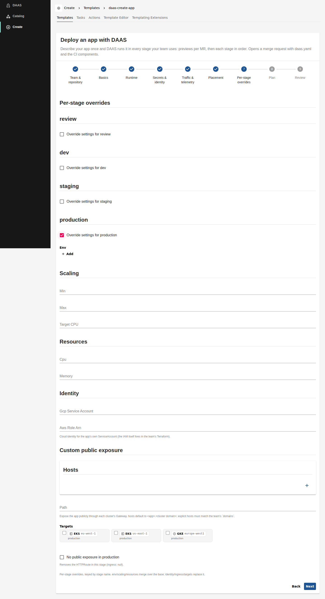

# DAAS for Backstage

Three plugins that put DAAS inside an existing Backstage app (new backend system, new frontend system):

| package | role | what it does |
|---|---|---|
| `plugins/daas` — `@internal/plugin-daas` | frontend | the **DAAS page** (overview, teams, apps, deployments, secrets), a **Deployments tab** on catalog entities, and the **scaffolder fields** the templates use |
| `plugins/daas-backend` — `@internal/plugin-daas-backend` | backend | `/api/daas` (permission-checked proxy to the DAAS read API), the **template generator** (catalog module), and the **scaffolder actions** (scaffolder module) |
| `plugins/daas-common` — `@internal/plugin-daas-common` | shared | API types, permissions, the schema → form mapping, YAML helpers |



## What people get

- **My teams first**: every page starts on the signed-in user's teams (their Backstage group
  memberships, matched to DAAS teams by the Group's `daas.io/team` annotation or its name), with a
  switch to **All teams**. This only sets what's shown first; it doesn't restrict what people can see.
- **Overview**: headline numbers, the stages as a promotion path (environment globs, GitLab tier,
  clusters per cloud and region), recent deployments and teams.
- **Teams**: each team's stages with their gates, its dedicated clusters, apps, owners, projects that
  may deploy, secret writers and preview quota.
- **Apps**: every app with what runs where; an app page shows one lane per environment (image,
  clusters, health, public hosts, preview expiry), the deployment history, and the deployed
  `daas.yaml` with **Edit daas.yaml**, which opens the update template pre-filled with it.
- **Deployments**: all rollouts with filters, polling while something is rolling out; expand one to
  see each wave, cluster, Argo revision and the failure message.
- **Secrets**: pick team, app and stage; see which secrets are set, which `daas.yaml` declares but are
  **missing** (the deploy would fail), and which are set but unused. Set, rotate and delete. Values
  are write-only: DAAS never returns them.
- **Entity tabs**: a **Deployments** tab on every Group (the team view: stages, gates, clusters,
  apps, access; or an "Onboard the team" button if it isn't a DAAS team yet), and on every
  Component annotated `daas.io/app: <team>/<app>` (that app's environments, rollouts and `daas.yaml`).
- **Templates** (in the scaffolder): *Deploy an app with DAAS*, *Change a DAAS app*, *Onboard a team
  to DAAS*. Each ends in a **merge request**; nothing deploys from Backstage.

| Team tab on a Group | App | Rollouts | Secrets |
|---|---|---|---|
|  |  |  |  |

## Dynamic templates

The templates are not files. The catalog module fetches `GET /v1/schemas` and `GET /v1/platform` from
DAAS every `daas.templates.refreshMinutes` (default 10) and generates the Template entities:

- one form step per group of `daas.yaml` fields (basics, runtime, secrets & identity, traffic,
  placement, per-stage overrides); any field the schema gains that the layout doesn't know yet appears
  under **Other settings**, with its type, enum, pattern and description from the schema;
- optional sections whose presence changes behavior (`ingress` exposes the app, `metrics` turns on
  scraping, and so on) sit behind a switch such as *Expose the app publicly*, so schema defaults
  never switch anything on by accident;
- **Per-stage overrides** lists exactly the stages in `stages.yaml`, each behind an *Override
  settings for <stage>* switch with no defaults filled in, so only what you change is written; **Team** lists the teams in the
  platform repo; **Onboard a team** uses the team JSON Schemas (`access`, `clusters`, `secrets`);
- DAAS widgets: team picker, **targets** (the team's provider/region pairs, in rollout order, first is
  the canary), key/value maps (env, labels), a secrets editor (team default, GCP or AWS), and a
  **review step** that renders the exact `daas.yaml`, has DAAS validate and plan it for the chosen
  team and environment (`POST /v1/preview`), and shows waves, hosts, warnings and missing secrets.

| Fields | Per-stage overrides |
|---|---|
|  |  |

Then the actions:

- `daas:spec:write` turns the form into `daas.yaml`, validates it with DAAS again (a rejected spec
  stops the task before anything is written), and on create also adds the DAAS CI components to
  `.gitlab-ci.yml`: a review include if the team uses a preview stage, then one deploy job per enabled
  stage in platform order. An existing `.gitlab-ci.yml` keeps its comments, jobs and other includes;
  old DAAS includes are replaced. It also makes sure `catalog-info.yaml` carries
  `daas.io/app: <team>/<app>`: it adds the annotation to the existing Component, or creates a
  Component owned by `group:default/<team>`. Once merged, your catalog's GitLab discovery picks it
  up and the entity gets its Deployments tab. The merge request description carries DAAS's plan.
- `daas:team:write` validates the three team files against the team schemas and writes
  `platform/teams/<team>/`. After merge, the platform pipeline regenerates the team README and
  CODEOWNERS (`python -m daas_api.team --write`).
- Both are followed by the built-in `publish:gitlab:merge-request`.

## Install

Copy the three folders into your Backstage repo's `plugins/` (or depend on them from this workspace),
then:

```bash
yarn --cwd packages/backend add @internal/plugin-daas-backend
yarn --cwd packages/app add @internal/plugin-daas
```

Backend (`packages/backend/src/index.ts`):

```ts
backend.add(import('@internal/plugin-daas-backend'));
backend.add(import('@internal/plugin-daas-backend').then(m => ({ default: m.catalogModuleDaasTemplates })));
backend.add(import('@internal/plugin-daas-backend').then(m => ({ default: m.scaffolderModuleDaas })));
// needed for the merge requests
backend.add(import('@backstage/plugin-scaffolder-backend-module-gitlab'));
```

Frontend: with feature discovery (`app.packages: all`) nothing else is needed. Otherwise:

```ts
import daasPlugin from '@internal/plugin-daas';
export default createApp({ features: [daasPlugin /* , ... */] });
```

The plugin brings its page (`/daas`), its API, the two entity tabs and the five scaffolder fields.
Annotations it reads:

```yaml
# a Component: the app's Deployments tab (the create/update templates add this for you)
metadata:
  annotations:
    daas.io/app: payments/checkout-api   # <team>/<app>
---
# a Group whose name differs from its DAAS team (otherwise the Group name is used)
metadata:
  annotations:
    daas.io/team: payments
```

## Configure

```yaml
daas:
  baseUrl: https://daas.example.com
  auth:
    entra:                                   # Backstage's own identity for read calls
      tenantId: ${AZURE_TENANT_ID}
      clientId: ${DAAS_BACKSTAGE_CLIENT_ID}
      clientSecret: ${DAAS_BACKSTAGE_CLIENT_SECRET}
      scope: api://daas/.default
  gitlab:
    host: gitlab.example.com
    platformRepoUrl: gitlab.example.com?owner=platform&repo=daas
    platformDir: platform
    componentProject: platform/daas-deploy   # the CI/CD catalog project with deploy / review
    componentVersion: 1.4.0
  templates:
    owner: group:default/platform
    refreshMinutes: 10
  ui:
    scaffolderPath: /create
    secretsScope: api://daas/.default        # the user's own token for secret calls

integrations:
  gitlab:
    - host: gitlab.example.com
      token: ${GITLAB_TOKEN}                 # opens the merge requests

auth:
  providers:
    microsoft:                               # people sign in with Entra ID
      production:
        clientId: ${AZURE_CLIENT_ID}
        clientSecret: ${AZURE_CLIENT_SECRET}
        tenantId: ${AZURE_TENANT_ID}
```

For local work against DAAS in dev mode, replace `auth.entra` with
`auth.devHeaders: { X-DAAS-Roles: payments.secrets }` and leave `ui.secretsScope` unset.

### Who can do what

| action | Backstage | DAAS |
|---|---|---|
| see the DAAS page, run the templates' preview | permission `daas.read` | the backend's Entra app (read API) |
| list, set, delete secrets | permission `daas.secrets.manage`, users only | the **user's own** Entra token: DAAS checks their role for that team and stage (`secretWriters`) |
| change an app or onboard a team | scaffolder permissions | the merge request: CODEOWNERS and protected branches decide |

With the permission framework off, every signed-in user has both Backstage permissions; DAAS's own
role check on secrets still applies. Everyone who can read sees all teams; *My teams* is a starting
view, not a restriction.

## Develop

```bash
cd backstage
yarn install
yarn tsc            # type-check all three
yarn test           # jest: schema → form, template generation, CI merge, actions, router, pages, fields
yarn lint
yarn workspace @internal/plugin-daas start   # the UI on in-memory data, http://localhost:3000/daas
```

The dev harness (`plugins/daas/dev`) needs no DAAS or backend. It signs you in as a member of
payments and identity and serves fixtures through a mock API that validates specs like DAAS does.
It also runs the real catalog and scaffolder pages: `/create` lists the three generated templates
and runs them against the mock (the merge request is simulated), and the catalog has the teams as
Groups and the apps as Components, so both entity tabs work (`/catalog/default/group/payments/daas`).
`/daas-fields` shows the scaffolder fields on their own. Tests and the harness load the real schemas from `../spec`,
so a schema change that breaks the forms fails the tests.
